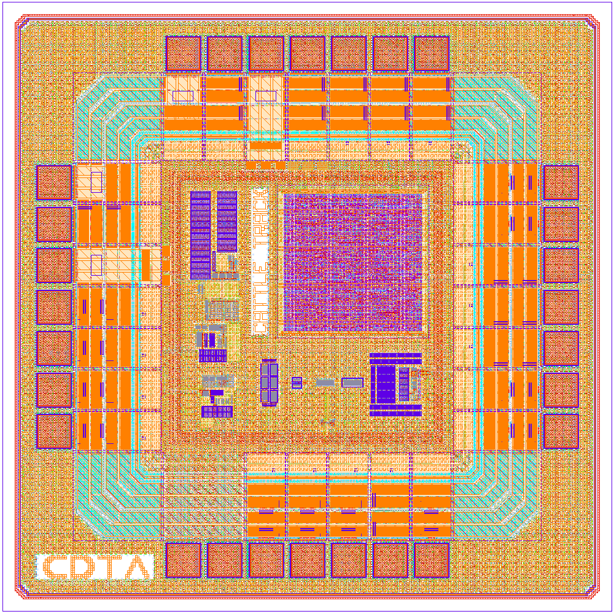
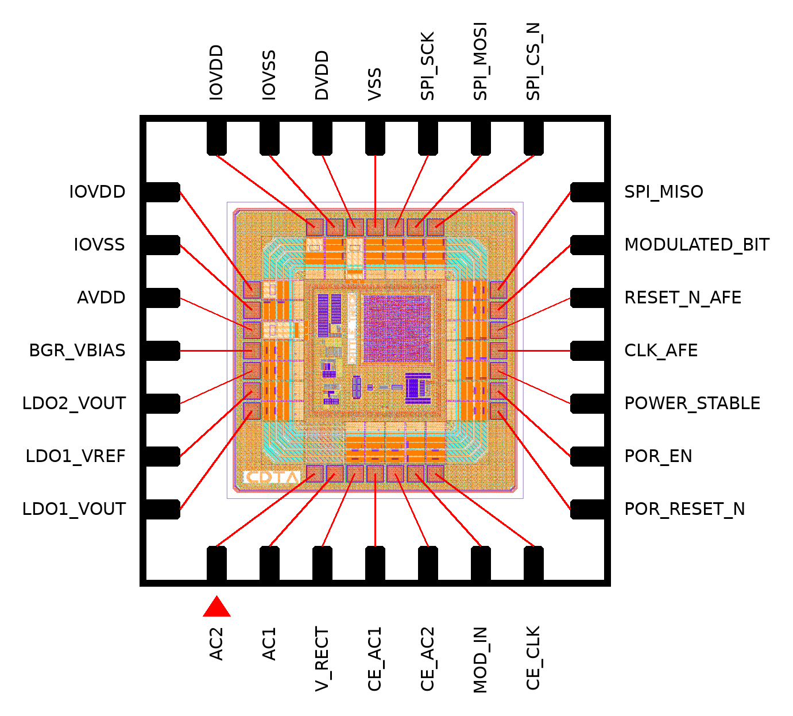

# RFID8549



|                |                                        |
| -------------- | -------------------------------------- |
| **Category**   | Mixed-Signal / LF RFID                 |
| **Standard**   | ISO 11784/11785 FDX-B, 134.2 kHz       |
| **Technology** | IHP SG13G2 (130 nm)                    |
| **Top Cell**   | `RFID8549`                             |
| **Die Size**   | 1250um x 1250um                        |
| **Pads**       | 28 (26 IO cells + 2 bare antenna pads) |
| **License**    | Apache-2.0                             |

---

## Pinout



Pin 1 is the bottom-left pin (red marker); pins are numbered counter-clockwise from
it. Pad IDs give the die side, counted left to right on N/S and bottom to top on E/W,
die seen from above as in the GDS. The map was traced from the release GDS.

| Pin | Pad | Name            | Type        | Function                                               |
| --: | --- | --------------- | ----------- | ------------------------------------------------------ |
|   1 | S1  | `AC2`           | antenna     | coil terminal 2, bare pad (no ESD)                     |
|   2 | S2  | `AC1`           | antenna     | coil terminal 1, bare pad (no ESD)                     |
|   3 | S3  | `V_RECT`        | analog out  | rectifier output                                       |
|   4 | S4  | `CE_AC1`        | analog in   | clock extractor input 1                                |
|   5 | S5  | `CE_AC2`        | analog in   | clock extractor input 2                                |
|   6 | S6  | `MOD_IN`        | digital in  | load modulator control                                 |
|   7 | S7  | `CE_CLK`        | digital out | clock extractor output (recovered carrier)             |
|   8 | E1  | `POR_RESET_N`   | digital out | power-on reset, active low                             |
|   9 | E2  | `POR_EN`        | digital out | power-on-reset enable                                  |
|  10 | E3  | `POWER_STABLE`  | digital in  | core start-up enable, also enables the clock extractor |
|  11 | E4  | `CLK_AFE`       | digital in  | core functional clock (134.2 kHz), also clocks the POR |
|  12 | E5  | `RESET_N_AFE`   | digital in  | core reset, active low                                 |
|  13 | E6  | `MODULATED_BIT` | digital out | bi-phase encoded telegram                              |
|  14 | E7  | `SPI_MISO`      | digital out | DFT SPI data out (tri-state)                           |
|  15 | N7  | `SPI_CS_N`      | digital in  | DFT SPI chip select, active low                        |
|  16 | N6  | `SPI_MOSI`      | digital in  | DFT SPI data in                                        |
|  17 | N5  | `SPI_SCK`       | digital in  | DFT SPI clock                                          |
|  18 | N4  | `VSS`           | ground      | core ground                                            |
|  19 | N3  | `DVDD`          | supply      | digital core supply, 1.2 V                             |
|  20 | N2  | `IOVSS`         | ground      | IO ring ground                                         |
|  21 | N1  | `IOVDD`         | supply      | IO ring supply                                         |
|  22 | W7  | `IOVDD`         | supply      | IO ring supply                                         |
|  23 | W6  | `IOVSS`         | ground      | IO ring ground                                         |
|  24 | W5  | `AVDD`          | supply      | analog supply rail                                     |
|  25 | W4  | `BGR_VBIAS`     | analog out  | bandgap bias output, also the LDO_2 reference          |
|  26 | W3  | `LDO2_VOUT`     | analog out  | LDO_2 output                                           |
|  27 | W2  | `LDO1_VREF`     | analog in   | LDO_1 reference input                                  |
|  28 | W1  | `LDO1_VOUT`     | analog out  | LDO_1 output                                           |

## Overview

RFID8549 is a passive, read-only LF tag for animal identification. In a 134.2 kHz
reader field it rectifies the carrier for power, recovers a clock from it, and sends a
128-bit ISO 11784/11785 FDX-B telegram from on-chip ROM by load modulation, repeating
it for as long as the field is present. The die holds the full analog front-end and
the digital baseband. Every signal between them goes through a pad, so each block can
be tested on its own, and an SPI test port reaches the digital core with no RF field.

### Features

- **Protocol** — ISO 11784/11785 FDX-B: 128-bit telegram, 32 carrier cycles per bit (4194 bit/s), bi-phase coding
- **ID storage** — 16 × 8-bit ROM holding the whole telegram: header, 64-bit ID, CRC-16, trailer

### Digital core sign-off

LibreLane on IHP SG13G2, corners `nom_typ_1p20V_25C`, `nom_slow_1p08V_125C` and `nom_fast_1p32V_m40C`.

| Metric                               | Value                                                    |
| ------------------------------------ | -------------------------------------------------------- |
| Flip-flops                           | 244                                                      |
| Standard cells                       | 1421 (+5206 fill)                                        |
| Utilisation                          | 31.3 %                                                   |
| Clocks                               | `CLK_AFE` 134.2 kHz (functional), `SPI_SCK` 4 MHz (test) |
| Worst setup slack                    | +61.65 ns                                                |
| Worst hold slack                     | +0.12 ns                                                 |
| DRC (Magic, KLayout) / LVS / antenna | 0 / 0 / 0                                                |

---

## Bring-up

### Board connections

The AFE and the digital core are not wired together on the die. Strap these pads on
the test board to run the tag from an RF field:

| From               | To                | Signal                                |
| ------------------ | ----------------- | ------------------------------------- |
| 7 `CE_CLK`         | 11 `CLK_AFE`      | recovered carrier clock               |
| 8 `POR_RESET_N`    | 12 `RESET_N_AFE`  | core reset                            |
| 9 `POR_EN`         | 10 `POWER_STABLE` | power good                            |
| 13 `MODULATED_BIT` | 6 `MOD_IN`        | encoded telegram to the modulator     |
| 2 `AC1`            | 4 `CE_AC1`        | carrier to the clock extractor        |
| 1 `AC2`            | 5 `CE_AC2`        | carrier to the clock extractor        |
| 3 `V_RECT`         | 24 `AVDD`         | rectified supply to the analog blocks |
| 28 `LDO1_VOUT`     | 19 `DVDD`         | regulated supply to the digital core  |

Leave the straps open to drive the core from a bench instrument or an MCU instead.

### Notes

- **`SPI_MISO` needs a pull-down.** The data and enable pins of its tri-state pad are
  swapped. With a pull-down the pad still reads correctly while the core drives MISO.
- **The bandgap reference output is not routed.** Drive `LDO1_VREF` from the bench.
- **`AC1` and `AC2` are bare bond pads** with no ESD protection, each about 200 Ω in
  series before the limiter.

---

## Quick Start

### Prerequisites

- [IHP SG13G2 Open PDK](https://github.com/IHP-GmbH/IHP-Open-PDK)
- [KLayout](https://www.klayout.de/)

### View the layout

```bash
klayout release/v.1.0.0/gds/RFID8549.gds
```

### Physical verification

The same DRC that the `Physical Verification` workflow runs on every push:

```bash
python3 $PDK_ROOT/ihp-sg13g2/libs.tech/klayout/tech/drc/run_drc.py \
  --path=release/v.1.0.0/gds/RFID8549.gds --run_dir=drc --mp=8 \
  --precheck_drc --no_offgrid --no_recommended --density_thr=8 --no_angle --disable_extra_rules
```

## Repository layout

| Path               | Contents                                                                                                                               |
| ------------------ | -------------------------------------------------------------------------------------------------------------------------------------- |
| `doc/`             | [specification](doc/Specification.md), [datasheet](doc/Datasheet.md), [TRL checklist](doc/TRL-Mixed-Signal-IP.md), [team](doc/TEAM.md) |
| `dependencies/`    | sub-blocks: `digital_core`, `BGR`, `LDO_1`, `LDO_2`, `POR`, `CE`, `LIMITER`, `MODULATOR`, `RECTIFIER`                                  |
| `release/v.1.0.0/` | immutable versioned delivery, GDS in `gds/`                                                                                            |

## License

Licensed under the [Apache License 2.0](https://www.apache.org/licenses/LICENSE-2.0).

```
Copyright 2026 RFID8549 Authors

Licensed under the Apache License, Version 2.0 (the "License");
you may not use this file except in compliance with the License.
You may obtain a copy of the License at

    http://www.apache.org/licenses/LICENSE-2.0
```
